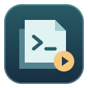

# Script Studio



A GTK desktop launcher that runs local Bash scripts in a queue. Select the scripts you need, follow their output, and review the saved session log.

**Version 1.0.1 · Joshua Dwight**

## Install on Ubuntu

Run the installer from the directory containing this README.

```bash
bash install.sh
```

The installer uses `sudo` to install Python 3, GTK 4, libadwaita, and PolicyKit dependencies. It registers **Script Studio** in your application menu. Launch it as your regular user and request administrator access for individual jobs when required.

## Run a queue

1. Click **Choose Folder** or use **File → Choose Folder…** to open the directory containing your scripts.
2. Search by filename and check the scripts you want to run. **Select All** selects the visible scripts. The queue includes checked scripts that match the current filter.
3. Click **Run Selected** and review the confirmation. Scripts run one at a time in the displayed order, with the chosen folder as the working directory.
4. Follow the **Execution Console** and the result next to each script. **Open Logs** opens the saved logs at `~/.local/state/script-studio/logs/`.

Script Studio remembers the chosen folder. It lists `.sh` files directly in that folder and skips symbolic links. Use **Refresh** to rescan after adding, renaming, or removing files, then select the scripts again.

## Permissions and stopping a run

- **Make Executable** adds execute permissions where read permissions already exist. An administrator prompt may appear for files you cannot modify.
- **Run as administrator** uses PolicyKit for script execution. It can ask for authentication for each script. Review the scripts before enabling it.
- **Stop Queue** skips pending items and requests termination of the running process group. Changes already made by a script remain in effect, and elevated child processes can continue running.

Script Studio invokes Bash explicitly. Use a terminal for scripts that require interactive input or a terminal session. Some programs buffer output, so their messages may appear together when the program finishes.

## Launchers and help

**File → Install in Application Menu** creates or refreshes the Ubuntu application menu entry. **File → Install Desktop Shortcut** creates or replaces the desktop launcher.

Open **Help → User Guide** for a full walkthrough or **Help → About** for version information. [User guide](./USER-GUIDE.txt) · [Changelog](./changelog.md)
